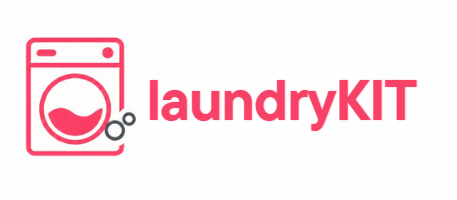

# LaundryKIT - Sistem Informasi Manajemen Laundry Modern

<p align="center">
  
</p>

<p align="center">
  <strong>Solusi Digital Operasional Laundry Cepat, Rapi, dan Terintegrasi</strong>
</p>

---

## 📌 Tentang LaundryKIT

**LaundryKIT** adalah aplikasi web manajemen laundry yang dibangun menggunakan framework **Laravel** dan antarmuka **Bootstrap 5**. Aplikasi ini dirancang untuk mempermudah operasional usaha laundry, mulai dari pencatatan data pelanggan, katalog layanan cuci, hingga pengelolaan inventaris bahan dan peralatan pendukung.

---

## ✨ Fitur & Modul Utama

### 1. 🏠 Halaman Publik & Landing Page
- Tampilan responsif yang memperkenalkan jasa laundry kepada pelanggan.
- Navigasi langsung menuju modul master data dan tombol akses cepat ke **Dashboard Admin**.

### 2. 📊 Dashboard Admin
- Widget statistik ringkas:
  - Total Pelanggan Aktif
  - Total Layanan Tersedia
  - Total Perlengkapan & Stok Barang
- Tabel ringkasan 5 data pelanggan, layanan, dan inventaris terbaru.

### 3. 👥 Master Data Pelanggan (CRUD)
- Formulir input lengkap: Nama Depan, Nama Belakang, Tanggal Lahir, Jenis Kelamin, Email (unik), dan No. Telepon.
- Validasi input server-side, repopulasi otomatis form saat validasi gagal, dan notifikasi *flash message* sukses.

### 4. 🧺 Master Data Layanan Cuci (CRUD)
- Katalog layanan cuci: Cuci Kiloan, Cuci Satuan, Dry Clean, dan Setrika Saja.
- Format harga Rupiah, satuan (Kg / Pcs), estimasi durasi pengerjaan (jam), dan deskripsi layanan.

### 5. 📦 Master Data Barang & Inventaris (CRUD)
- Pengelolaan stok: Deterjen & Sabun, Pewangi & Softener, Plastik Kemasan, serta Peralatan & Hanger.
- Pemantauan level stok dan status ketersediaan (*Tersedia*, *Menipis*, *Habis*).

### 6. 🧪 Automated Testing & Data Seeding
- Dilengkapi dengan *Feature Test* untuk seluruh alur CRUD dan validasi (Pelanggan, Layanan, Barang, dan Seeder).
- Tersedia Seeder & Factory (`DatabaseSeeder`, `PelangganSeeder`, `LayananSeeder`, `BarangSeeder`) untuk menginisialisasi database dengan data contoh.

---

## 🚀 Panduan Instalasi & Menjalankan Proyek

### 1. Kloning Repository
```bash
git clone https://github.com/yessa25si-max/laundrKIT.git
cd laundrKIT
```

### 2. Install Dependensi PHP
```bash
composer install
```

### 3. Konfigurasi Environment (`.env`)
Salin file `.env.example` menjadi `.env`:
```bash
cp .env.example .env
```
Lalu buat application key baru:
```bash
php artisan key:generate
```

### 4. Menjalankan Database (MySQL / Laragon)
> ⚠️ **Catatan Penting bagi Pengguna Laragon**:
> Pastikan aplikasi Laragon sudah dibuka dan tombol **"Start All"** sudah ditekan agar MySQL Server aktif pada port `3306`. Jika MySQL belum aktif, aplikasi akan menampilkan error `SQLSTATE[HY000] [2002] Connection refused`.

Pastikan konfigurasi database di file `.env` sudah sesuai:
```env
DB_CONNECTION=mysql
DB_HOST=127.0.0.1
DB_PORT=3306
DB_DATABASE=laravel
DB_USERNAME=root
DB_PASSWORD=
```

### 5. Jalankan Migrasi & Seeder
Buat tabel dan isi data contoh awal:
```bash
php artisan migrate --seed
```

### 6. Menjalankan Server Aplikasi
Jalankan development server Laravel:
```bash
php artisan serve
```
Akses aplikasi melalui browser di [http://localhost:8000](http://localhost:8000).

---

## 🧪 Menjalankan Pengujian (Testing)

Untuk memastikan seluruh modul dan logika bisnis berjalan dengan baik:
```bash
php artisan test
```

---

## 🛠️ Tech Stack
- **Framework Backend:** Laravel 12 (PHP 8.4)
- **Frontend / UI:** Blade Templates, Bootstrap 5, FontAwesome
- **Database:** MySQL / MariaDB (Laragon) & SQLite (Testing)
- **Testing Engine:** PHPUnit
